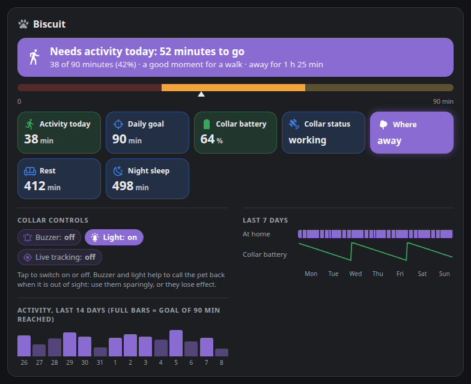
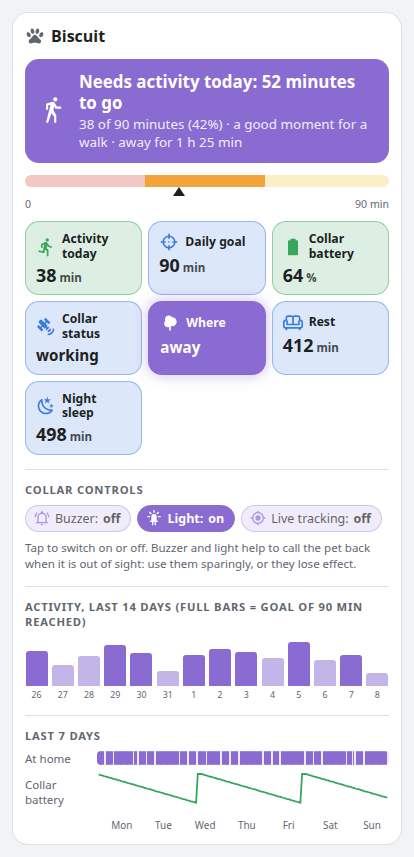

# Tractive Pet Card

A Home Assistant dashboard card for the dogs and cats tracked with the official
[Tractive integration](https://www.home-assistant.io/integrations/tractive/). One look tells you whether your pet
needs a walk today.



- A banner on top: *Needs activity today: 52 minutes to go*, *Almost there*, or *Goal reached*. It turns red when the
  collar battery is low and amber when the collar is not reporting.
- Today's activity on a scale up to the daily goal, then tiles for activity, goal, collar battery, collar status,
  where the pet is (*at home since 14:05* or *away for 47 min*), and rest and sleep when Tractive provides them.
- The collar controls (buzzer, light, live tracking): tap to switch them on or off. When they are unavailable because
  the collar is in power saving mode, the card says so.
- The last 14 days of activity (full bars on the days the goal was reached), and the last 7 days of presence at home
  and of collar battery.
- Several pets: one section each, or pick one with `pet:`.
- No animations, works at phone width, follows your light or dark theme. English and Italian.



## Requirements

- Home Assistant 2024.8 or newer with the **Tractive** integration.
- Activity, goal, rest and sleep have values only with a Tractive subscription that includes health data. Without
  them (the sensors exist but never get a value) the card says so and still shows location, battery, status and collar
  controls.

## Installation

### Marketplace (Home Assistant 2026.11 and newer)

Until the card is in the default catalogue, add it by link: open **Settings → Marketplace**, choose
**Add from link**, paste `https://github.com/AldebaranPrimo/tractive-pet-card`, then install **Tractive Pet Card**.
Reload the page in the browser afterwards.

### HACS (before 2026.11)

HACS → three dots → **Custom repositories** → add `https://github.com/AldebaranPrimo/tractive-pet-card` with type
**Dashboard**, then download **Tractive Pet Card**.

### Manual

Copy `tractive-pet-card.js` to `/config/www/`, then add a dashboard resource (Settings → Dashboards → three dots →
Resources) with URL `/local/tractive-pet-card.js` and type **JavaScript module**.

## Configuration

Nothing to configure: the card finds every entity of the Tractive integration and groups them by pet (the pet device
and the collar device it is connected through).

```yaml
type: custom:tractive-pet-card
```

With more than one pet, show only one:

```yaml
type: custom:tractive-pet-card
pet: Biscuit
color: "#e07a3a"
```

### Options

| Option | Default | Description |
|---|---|---|
| `pet` | all pets | Name of the pet (as in the Tractive app) or its device id. |
| `title` | the pet's name, or *Pets* | Card title. `""` hides it. |
| `color` | `#8a6bd1` | Colour of the pet as `#rrggbb`: banner, bars, presence. Text on it turns black or white, whichever reads better. |
| `days` | `14` | Days in the activity bars. |
| `goal` | none | Daily goal in minutes, used only when Tractive gives none. |
| `show_controls` | `true` | Collar controls. |
| `show_history` | `true` | Last 7 days of presence and battery. |
| `language` | Home Assistant language | `en` or `it`; other languages fall back to English. |
| `entities` | found automatically | Map to set or replace entities, see below. |
| `name` | | Pet name when you set the entities by hand. |

### Setting entities by hand

Useful if the automatic search misses something, or to add a person whose presence follows the collar. Any key
can be left out.

```yaml
type: custom:tractive-pet-card
name: Biscuit
entities:
  activity: sensor.biscuit_activity_time      # Activity time
  goal: sensor.biscuit_daily_goal             # Daily goal
  rest: sensor.biscuit_rest_time
  daySleep: sensor.biscuit_day_sleep
  nightSleep: sensor.biscuit_night_sleep
  battery: sensor.biscuit_tracker_battery_level
  charging: binary_sensor.biscuit_tracker_battery_charging
  status: sensor.biscuit_tracker_state
  powerSaving: binary_sensor.biscuit_tracker_power_saving
  tracker: device_tracker.biscuit_tracker
  person: person.biscuit                       # optional: presence from a person instead of the tracker
  buzzer: switch.biscuit_tracker_buzzer
  led: switch.biscuit_tracker_led
  live: switch.biscuit_live_tracking
```

## How it works

- **Finding the entities**: entities of the `tractive` platform, recognised by their translation key (or, failing
  that, by the end of the entity id), grouped by device. The collar is linked to its pet through the pet device's
  *connected via*. A person whose device trackers include the collar is used for *at home since*.
- **Activity per day**: from the hourly long-term statistics of *Activity time*. Tractive restarts the counter at the
  first sync after midnight; until then the sensor keeps yesterday's final value. A new day starts at the first value
  that differs from yesterday's last one, lower or higher.
- **Today**: until the counter restarts, today counts as 0 minutes, not as yesterday's total.
- **Collar controls**: Tractive makes them unavailable while the collar saves power (usually at home or charging).

## Licence

[MIT](LICENSE)
